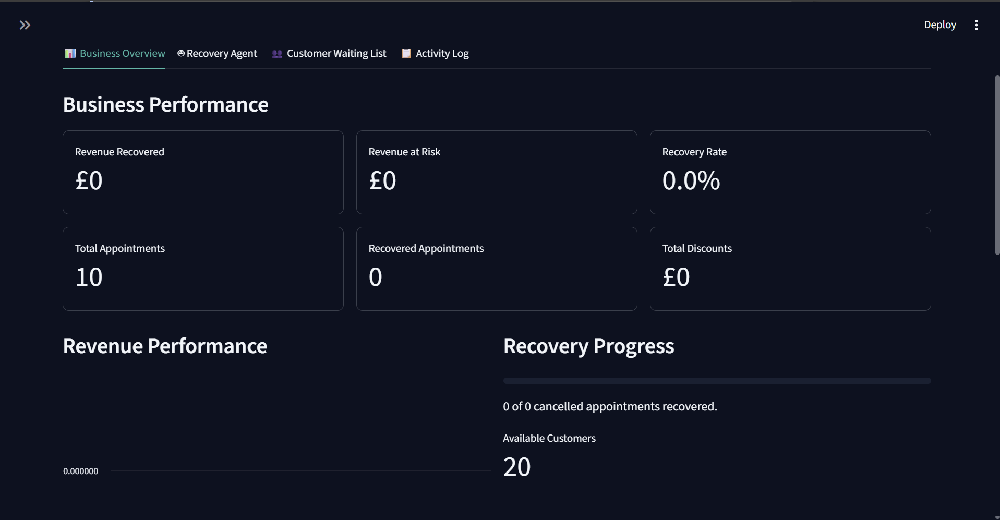
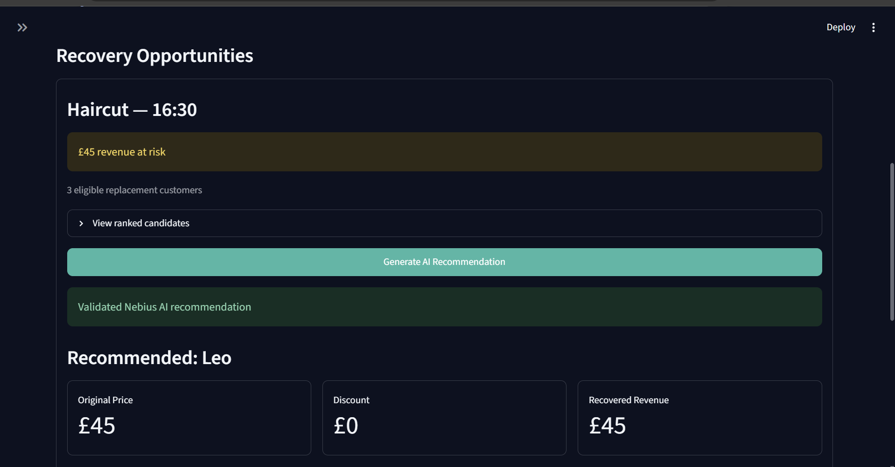
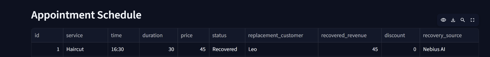
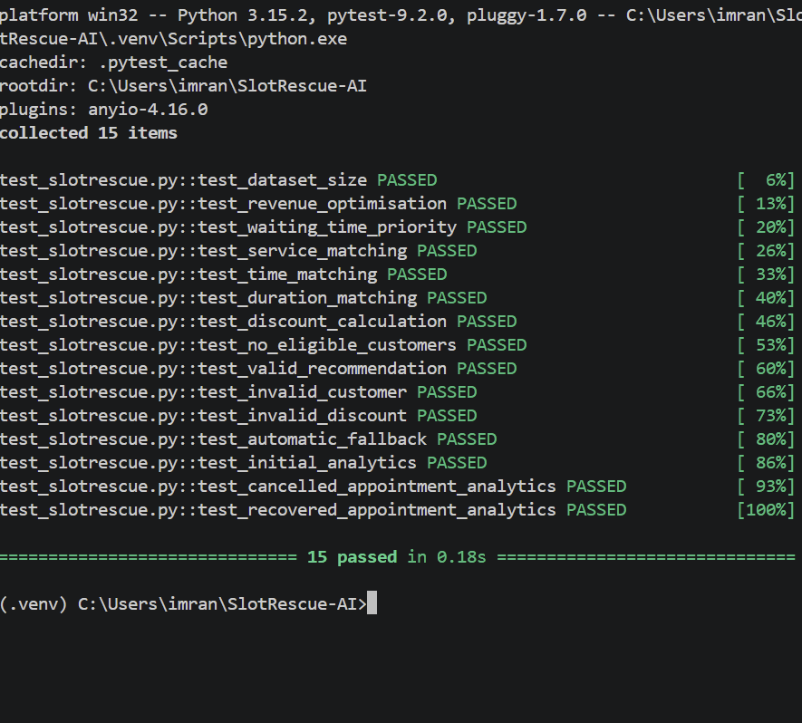

# SlotRescue AI

### Intelligent Appointment Recovery Agent

Built for the Retail AI & Agents Hackathon 2026 using Nebius Token Factory.

## The Problem

Last-minute appointment cancellations create unused capacity and lost revenue for beauty and wellness businesses. Manually contacting customers on waiting lists can be inefficient and time-consuming.

## Our Solution

SlotRescue AI is an AI-powered appointment recovery agent that identifies eligible replacement customers, recommends suitable discounts and generates personalised appointment offers while keeping business owners in control.

## Key Features

- Interactive appointment cancellation simulation.
- Intelligent customer eligibility filtering.
- Revenue-based customer ranking.
- Waiting-time prioritisation.
- Live Nebius AI recommendations.
- Personalised customer offers.
- AI response validation.
- Automatic rule-based fallback.
- Human approval and rejection.
- Duplicate customer booking prevention.
- Real-time revenue analytics.
- Timestamped agent activity log.
- Interactive Streamlit dashboard.

## Application Screenshots

### Business Dashboard


### AI Recovery Agent


### Successful Appointment Recovery


### Automated Testing


## Technology Stack

| Technology | Purpose |
|---|---|
| Python | Application logic |
| Streamlit | Interactive dashboard |
| Nebius Token Factory | Large language model inference |
| Qwen3-235B-A22B | AI recommendations |
| Requests | API communication |
| Python-dotenv | Environment variable management |
| Pytest | Automated testing |
| Git and GitHub | Version control |

## How It Works

1. A business owner simulates an appointment cancellation.
2. The matching engine filters customers by service, availability, duration and budget.
3. Eligible customers are ranked by potential recovered revenue and waiting time.
4. The Nebius AI agent evaluates candidates and generates a structured recommendation.
5. Python validates the recommendation against the eligible candidates.
6. If the AI fails or produces an invalid recommendation, a deterministic fallback is used.
7. The business owner approves or rejects the recommendation.
8. The dashboard updates simulated revenue and records the decision.

## Project Structure

```text
SlotRescue-AI/
├── .streamlit/
│   └── config.toml
├── app.py
├── agent.py
├── analytics.py
├── data.py
├── matching.py
├── validation.py
├── test_slotrescue.py
├── test_nebius.py
├── requirements.txt
├── .gitignore
└── README.md
```

## Installation

Clone the repository:

```bash
git clone https://github.com/imranbekri/SlotRescue-AI.git
cd SlotRescue-AI
```

Create a virtual environment:

```bash
python -m venv .venv
```

Activate it on Windows:

```bash
.venv\Scripts\activate
```

Install dependencies:

```bash
pip install -r requirements.txt
```

Create a local `.env` file:

```env
NEBIUS_API_KEY=your_api_key_here
NEBIUS_MODEL=Qwen/Qwen3-235B-A22B-Instruct-2507
NEBIUS_API_URL=https://api.tokenfactory.nebius.com/v1/chat/completions
```

Run the application:

```bash
python -m streamlit run app.py
```

## Automated Testing

The project includes 15 automated tests covering customer matching, revenue optimisation, discount calculations, recommendation validation, automatic fallback and analytics.

Run the tests using:

```bash
python -m pytest test_slotrescue.py -v
```

## Example Recovery Scenario

A £60 massage appointment is cancelled. The matching engine identifies suitable customers and ranks them according to potential revenue.

If a customer is willing to pay the full £60, the agent can recommend recovering the appointment without offering an unnecessary discount.

Following human approval, the dashboard records £60 in simulated recovered revenue.

## Responsible AI

SlotRescue AI combines AI-generated recommendations with deterministic business rules and human oversight.

- Recommendations are validated before approval.
- Discounts are restricted by predefined business rules.
- API credentials are stored outside version control.
- Rebooking requires human approval.
- Failed AI requests trigger a rule-based fallback.

## Limitations

This is a hackathon prototype using 10 fictional appointments and 20 fictional customers. Application state is stored within the Streamlit session.

No real appointments, payments or customer messages are created. The application is not connected to Fresha's live booking infrastructure.

## Future Development

- Persistent database integration.
- Real-time booking platform integration.
- Automated customer notifications.
- Business authentication.
- Historical revenue reporting.
- Multi-location appointment management.

## Acknowledgements

Developed during the Retail AI & Agents Hackathon 2026 using Nebius Token Factory.

